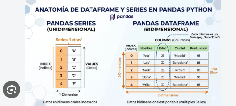
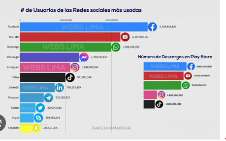
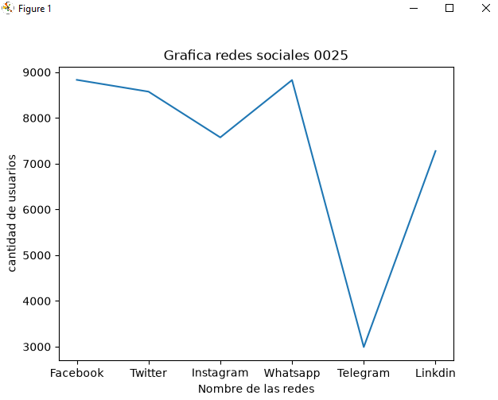
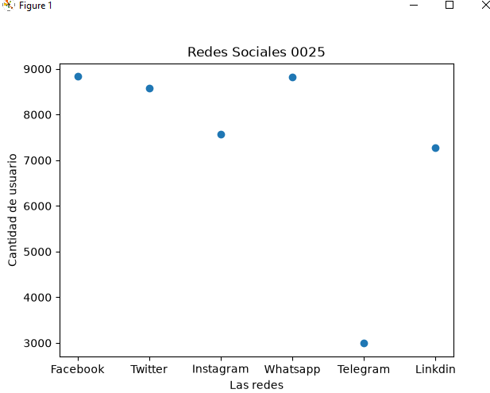
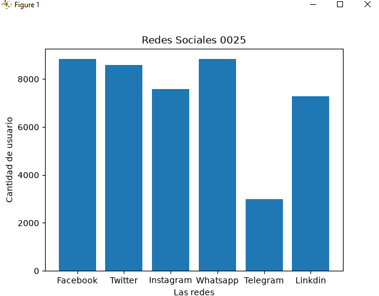
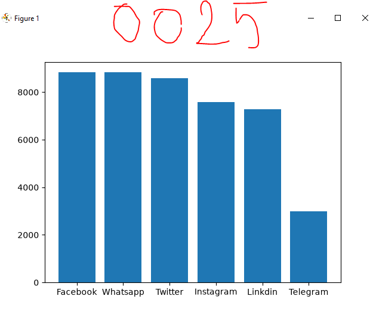
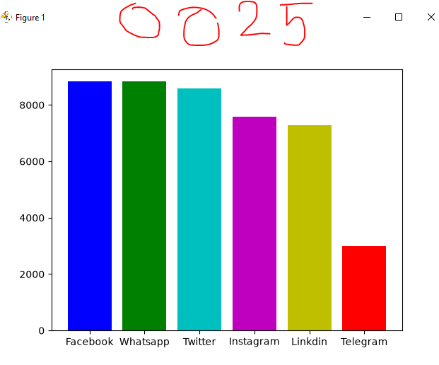
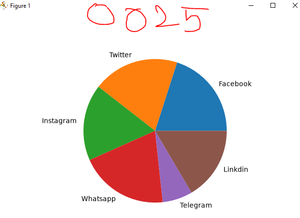

## DataFrame o marco de datos de panda

## Redes Sociales a nivel mundial 

## Grafica lineal de redes sociales 

## Grafica de puntos de redes sociales

## Grafica de barras redes sociales

## Grafica de barras del más grande al más pequeño

## coloreando graficas

## Grafica Pastel
